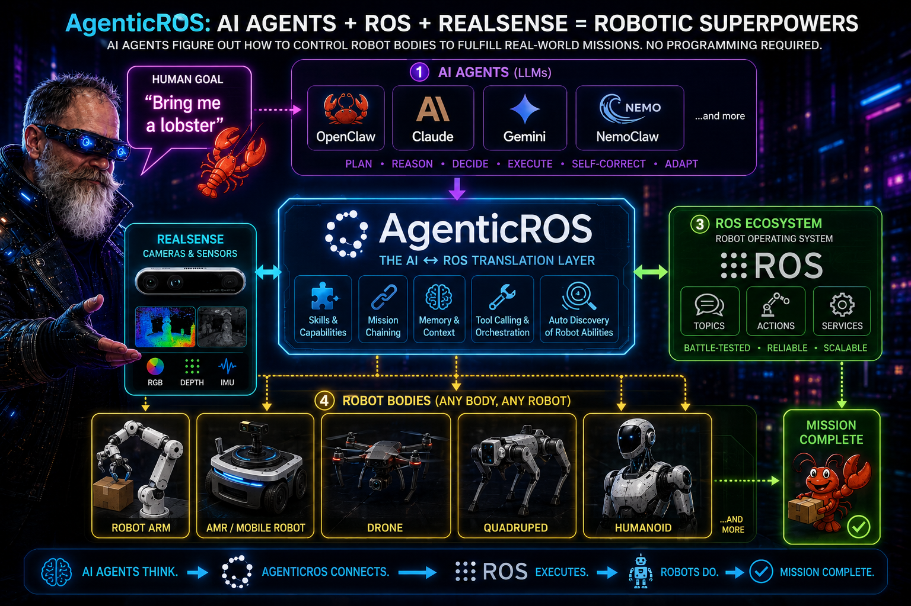
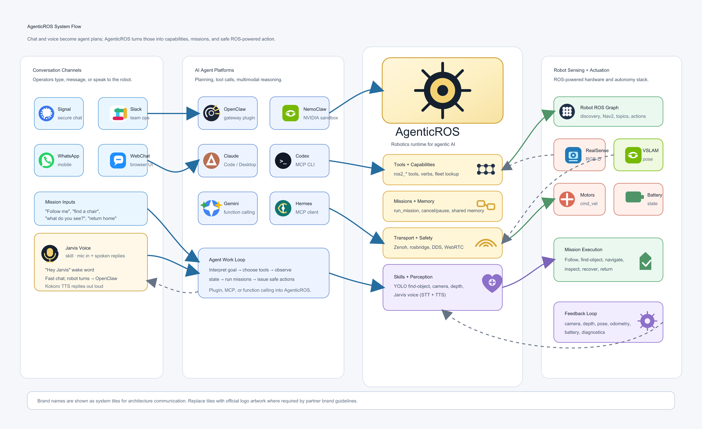

# Corebrum Synapse

This project was previously known as AgenticROS.


This project was previously known as Corebrum Synapse.


```text
    _                     _   _       ____   ___  ____
   / \   __ _  ___ _ __ | |_(_) ___ |  _ \ / _ \/ ___|
  / _ \ / _` |/ _ \ '_ \| __| |/ __|| |_) | | | \___ \
 / ___ \ (_| |  __/ | | | |_| | (__ |  _ <| |_| |___) |
/_/   \_\__, |\___|_| |_|\__|_|\___||_| \_\___/|____/
        |___/
  Corebrum Synapse - agentic AI for ROS-powered robots
```

**Physical AI Agents for ROS Robots**



[](https://www.youtube.com/watch?v=_fbWhYcPj0M)

> ▶ [Watch the Corebrum Synapse intro on YouTube](https://www.youtube.com/watch?v=_fbWhYcPj0M)

Corebrum Synapse turns ROS 2 robots into agent-native machines. Speak, type, or message — and your robot perceives, reasons, and acts. It is an open, AI-agent-agnostic interface layer that bridges the world of frontier reasoning models with the world of cameras, depth sensors, motors, and `cmd_vel`, so robots stop being remote-controlled tools and start collaborating like teammates.

With Corebrum Synapse, your robot can describe what it sees, follow intent ("go check the front door"), run skills you author, and respond to natural language across the agent platforms you already use. **One ROS 2 workspace, one config, many agents.**

**Building a robot from parts?** Start with the **[hardware getting started guide](docs/hardware.md)** — reference BOM (Jetson or Pi / RADXA / LattePanda / x86+Arduino), L298N GPIO wiring for `/cmd_vel` and `/odom`, RealSense, then OpenClaw and other agents.

## Supported AI Agent platforms

- **[OpenClaw](https://openclaw.ai)** — Native gateway plugin with ROS 2 tools, commands, a config UI, a teleop web app, and a skill loader. The flagship integration.
- **[NVIDIA NemoClaw](https://github.com/NVIDIA/NemoClaw)** — Run Corebrum Synapse inside NemoClaw's OpenShell sandbox with policy-enforced egress and managed NVIDIA inference; ROS 2, RealSense, and rosbridge stay on the host while the plugin runs sandboxed.
- **[Anthropic Claude](https://www.anthropic.com/claude)** — A single MCP server powers **Claude Code** (terminal), **Claude Desktop** (macOS / Windows), and **Claude Dispatch** (iOS, paired to your Mac). Ask Claude what your robot sees, and it answers with a live camera snapshot and depth reading.
- **[OpenAI Codex CLI](https://developers.openai.com/codex/)** — Same MCP server as Claude Code. One command registers Codex: `synapse codex setup` (writes `~/.codex/config.toml` with an absolute path to the MCP binary). Full tool surface: missions, follow-me, find-object, memory. Setup guide: [docs/codex-setup.md](docs/codex-setup.md).
- **[Hermes Agent](https://github.com/NousResearch/hermes-agent)** — Model-agnostic agent gateway (OpenRouter, Ollama, 200+ providers) with MCP client support. Same MCP server as Codex: `synapse hermes setup` writes `~/.hermes/config.yaml`. Setup guide: [docs/hermes-setup.md](docs/hermes-setup.md).
- **[Google Antigravity CLI](https://antigravity.google/docs/cli/)** (`agy`) — Same MCP server, using your Antigravity subscription (no `GEMINI_API_KEY`). `synapse agy setup` writes `~/.gemini/config/mcp_config.json` and installs the Corebrum Synapse skill. Run a prompt with `synapse agy run`. Setup guide: [docs/agy-setup.md](docs/agy-setup.md).
- **[Google Gemini](https://ai.google.dev/)** — Standalone CLI that uses Gemini function calling against the same ROS 2 tools (no MCP required) — ideal for scripting and headless agents. This path needs `GEMINI_API_KEY`. Antigravity CLI is the subscription path above.

Corebrum Synapse is built so that new adapters (LangGraph, OpenAI, local models, voice stacks, etc.) can be added without touching the ROS 2 layer. The core transport and tool contract are platform-agnostic; adapters are thin shims that surface those tools to each agent runtime.

## Local VLM (Ollama) — no cloud API required

Control your robot with a **local vision-language model** instead of OpenAI or other cloud APIs. Corebrum Synapse robot tools work the same; you point **OpenClaw** or **Hermes** at Ollama on your machine.

```bash
ollama pull qwen3-vl:8b-instruct   # recommended: chat + tools + camera vision
# or: ollama pull qwen3-vl:2b     # smaller hardware

npx @corebrum/synapse init               # skip the OpenAI key step when prompted
# Configure OpenClaw to use Ollama as primary model (see guide below)
synapse up sim-amr             # or: synapse up real
```

Then chat in OpenClaw web UI or Hermes: *"List ROS topics"*, *"drive forward slowly"*, *"what do you see?"*

| Path | Best for |
|------|----------|
| **OpenClaw + Ollama** | Web chat, teleop, messaging channels, skills |
| **Hermes + Ollama** | Terminal agent with any Ollama model |
| **NemoClaw + Ollama** | Sandboxed Jetson / edge (see [docs/nemoclaw.md](docs/nemoclaw.md)) |

**Full setup, model picks, multimodal catalog patches, describer, Follow Me VLM, and troubleshooting:** **[docs/local-vlm.md](docs/local-vlm.md)**

## Architecture



- **Core** (`packages/core`): Platform-agnostic ROS2 transport (Zenoh, rosbridge, local DDS, WebRTC), capability/mission runtime, shared memory, config schema, and types. No dependency on any specific AI platform.
- **Adapters**: OpenClaw plugin (`packages/synapse-openclaw`, including [NemoClaw](docs/nemoclaw.md)); MCP server (`packages/synapse-claude-code`) for **Claude Code / Desktop / Dispatch**, **Codex CLI**, **Hermes Agent**, and **Antigravity CLI** (`agy`); Gemini API CLI (`packages/synapse-gemini`) via function calling. See [packages/synapse-claude-code/README.md](packages/synapse-claude-code/README.md), [docs/codex-setup.md](docs/codex-setup.md), [docs/hermes-setup.md](docs/hermes-setup.md), and [docs/agy-setup.md](docs/agy-setup.md).
- **Perception**: `@corebrum/ros-camera` (Image / CompressedImage snapshots) and `@corebrum/object-detection` (YOLOv8n find-object), shared by every adapter.

```
User (messaging app) → OpenClaw Gateway → Corebrum Synapse OpenClaw plugin → Core → ROS2 robots
Claude (Code / desktop / Dispatch) → synapse MCP server → Core → ROS2 robots (Zenoh/rosbridge)
Codex CLI → synapse MCP server → Core → ROS2 robots (Zenoh/rosbridge)
Hermes Agent → synapse MCP server → Core → ROS2 robots (Zenoh/rosbridge)
Antigravity CLI (agy) → synapse MCP server → Core → ROS2 robots (Zenoh/rosbridge)
Gemini CLI → @corebrum/gemini (function calling) → Core → ROS2 robots
```

## A shared mission language for robots

The same tool surface across every adapter — Claude Code, Codex, Hermes, Antigravity CLI, Gemini, OpenClaw — so two different agents on two different stacks can both speak the same dialect when controlling the same robot. Built around five capabilities.

### Capability manifests — robots advertise *verbs*

Every Corebrum Synapse-enabled robot exposes a typed list of named verbs through `ros2_list_capabilities`: `drive_base`, `take_snapshot`, `measure_depth`, `find_object`, `follow_person`, plus whatever a [skill package](#skills) contributes. The agent plans against the verbs instead of raw ROS 2 topics — and the manifest is shaped to double as an ACP / A2A agent card.

### Mission chaining — `run_mission`

One MCP tool, `run_mission`, executes a declarative step graph. Each step is `{ id, capability, inputs, on_fail }`. Outputs from any step flow into later steps via `{{stepId.outputs.field}}` template references — so a detection wires straight into the next motion command with no glue code:

```json
{
  "steps": [
    { "id": "find",     "capability": "find_object", "inputs": { "target": "chair" } },
    { "id": "approach", "capability": "drive_base",
      "inputs": {
        "linear_x": 0.2,
        "angular_z": "{{find.outputs.horizontal_offset}}"
      }
    }
  ]
}
```

### Natural-language goals

`run_mission` also accepts a `goal` field — plain English. A rule-based, deterministic planner in `@corebrum/core` compiles it into a runnable mission against the robot's capability registry:

- `"take a picture"` → `take_snapshot`
- `"follow me"` → `follow_person`
- `"drive forward at 0.3 m/s"` → `drive_base { linear_x: 0.3 }`
- `"find a chair and drive toward it"` → the two-step compound plan above

No LLM dependency (the planner is a few hundred lines of pattern matching, so the runtime doesn't require Ollama) and no fabricated calls (it only emits capabilities actually in the registry). Uncompilable goals return a clean error with the recognised-verb list so the agent can self-correct.

### Multi-robot fleets

`ros2_list_robots`, `ros2_discover_robots`, and `ros2_find_robots_for({ capability, kind?, online? })` let an agent ask *"give me an AMR that can `follow_person` and is currently online"* and get back a ranked list. The CLI keeps fleet metadata in sync without hand-editing JSON:

```bash
synapse robots add my-amr \
  --kind=amr --sensors=has_realsense,!has_arm \
  --capabilities=drive_base,take_snapshot,follow_person
```

On the ROS side, every robot publishes a 1 Hz heartbeat on `<ns>/synapse/robot_info` so the online filter reflects what's actually reachable. A single mission can route different steps to different robots — *"the AMR finds the box, the arm picks it up"* runs as one mission.

### Cancel + shared transcripts

`mission_cancel({ mission_id })` flips an in-process cancellation token; the runner stops at the next step boundary and marks remaining steps `cancelled`. When the [shared memory backend](#memory-optional) is on, every step is also written to `mission:<id>` in long-term memory, tagged with `step:<status>` and `capability:<id>`. A different agent — different process, different vendor — can `memory_recall` later and reconstruct exactly what happened, so two agents can collaborate on or hand off a mission.

**How-to:** step-by-step fleet setup, declarative plans, NL goals, cancel, and handoff — **[docs/missions.md](docs/missions.md)**. Runnable walkthrough: **[examples/find-and-approach/README.md](examples/find-and-approach/README.md)**.

Full architecture + design trade-offs: **[docs/strategy-ai-agents-plus-ros.md](docs/strategy-ai-agents-plus-ros.md)**.

## Repository layout

- `**packages/core**` — Transport, types, config (Zod). Used by all adapters.
- `**packages/synapse-openclaw**` — OpenClaw plugin: tools, commands, config page, teleop routes.
- `**packages/synapse-claude-code**` — MCP server for Claude Code, Claude desktop / Dispatch, Codex, Hermes, and Antigravity CLI (tools only; no config UI).
- `**packages/synapse-gemini**` — Gemini API CLI (function calling; needs `GEMINI_API_KEY`). Separate from Antigravity CLI.
- `**packages/robot-eyes**` — On-robot face display (`synapse eyes`): animated eyes follow `cmd_vel` turns; when idle, follow a person in the RealSense camera if YOLO is already installed. Optional WASD. See [docs/eyes.md](docs/eyes.md).
- `**ros2_ws/**` — ROS2 workspace: `synapse_msgs`, `synapse_bringup` (Gazebo + RViz + rosbridge launches), `synapse_discovery`, `synapse_agent`, `synapse_follow_me`.
- `**docs/**` — Architecture, **[hardware getting started](docs/hardware.md)**, skills, robot setup, Zenoh (`npx zenoh-fleet` for Mode D fleets), teleop, eyes, **[local VLM / Ollama](docs/local-vlm.md)**.
- `**scripts/**` — Workspace setup, gateway plugin config, run demos.
- `**docker/**` — Docker Compose and Dockerfiles for ROS2 + plugin images.
- `**examples/**` — Example projects.

## Install

You only need one command. The `synapse` CLI handles everything else —
installing the ROS 2 workspace, building the MCP server, registering the
OpenClaw plugin, and wiring up your robot config.

```bash
npx @corebrum/synapse
```

That's it. Run it on any machine with **Node ≥ 20**, no `git clone` required.
If you are still wiring motors and a camera, do that first: **[docs/hardware.md](docs/hardware.md)**.
The first run launches the interactive menu:

```text
╔──────────────────────────────────────────────────╗
║  Corebrum Synapse - agentic AI for ROS-powered robots  ║
╚──────────────────────────────────────────────────╝

? What would you like to do?
  Launch with real robot
❯ Launch with simulation
  First-time setup (workspace + OpenClaw plugin + Codex MCP + optional API key)
  Manage skills (2 registered, 0 available, 0 broken)
  Stop everything
  Doctor (health check)
  Configure (API keys, namespace, transport)
  Tail logs
```

Pick **First-time setup** once (workspace + OpenClaw plugin + optional Codex MCP + optional API key, all
idempotent). **Using local Ollama instead of OpenAI?** Skip the API key step — see **[Local VLM (Ollama)](#local-vlm-ollama--no-cloud-api-required)**. Then choose how you want to run:

| You want to … | Pick |
|---|---|
| Drive your **real robot** (RealSense + motors + MCP) | **Launch with real robot** |
| Demo a **simulated 2-wheel AMR** in Gazebo + RViz | **Launch with simulation → AMR** |
| Demo a **simulated 6-DOF arm** (UR5e-shaped, per-joint position control) | **Launch with simulation → 6-DOF arm** |

Once a stack is up, point any of the supported agents — OpenClaw, Claude Code,
OpenAI Codex, Hermes Agent, Antigravity CLI, Claude Desktop / Dispatch, or Gemini CLI — at the same robot and start talking
to it. The CLI tracks what it spawned (pidfiles + logs under `/tmp/synapse-*`),
so **Stop everything** cleanly tears the demo down.

Prefer scripted invocations? Every menu item maps to a direct command:

```bash
npx @corebrum/synapse init             # one-time workspace + plugin + MCP clients (+ optional API key)
synapse mcp setup            # Codex, Hermes, Claude, and Antigravity
synapse codex setup          # register Corebrum Synapse MCP for OpenAI Codex CLI
synapse codex doctor         # validate ~/.codex/config.toml
synapse hermes setup         # register Corebrum Synapse MCP for Hermes Agent
synapse hermes doctor        # validate ~/.hermes/config.yaml
synapse agy setup            # register Corebrum Synapse MCP for Antigravity CLI
synapse agy doctor           # validate mcp_config.json + skill
synapse agy run "list topics"  # one prompt on your Antigravity subscription
synapse up real              # real robot stack
synapse up real --map        # real robot + RTAB-Map + Nav2
synapse up real --eyes       # real robot + on-display robot eyes
synapse up sim-amr           # simulated AMR (Gazebo + RViz, headless on Jetson)
synapse up sim-amr --nav2    # AMR + Nav2 for navigate_to missions
synapse up sim-arm           # simulated 6-DOF arm (per-joint /arm/*/cmd_pos)
synapse up sim-arm --moveit  # arm + MoveIt2 move_group + trajectory bridge
synapse skills install --bundle mapping   # start-slam + explore + navigate-to
synapse maps list                          # room maps on this robot
synapse maps create --label Kitchen --start
synapse maps use <id>                      # switch rooms and localize
synapse eyes                 # fullscreen robot eyes on a tablet / head unit
synapse mode <real|sim>      # swap the active config profile (namespace, transport)
synapse robots               # list / add / remove robots in the fleet (kind, sensors, capabilities)
synapse skills               # list / add / remove Corebrum Synapse skills (see below)
synapse doctor               # coloured health check
synapse down                 # stop everything we started
```

Full CLI reference: **[packages/synapse-cli/README.md](packages/synapse-cli/README.md)**.

### Requirements

- **Node.js ≥ 20** (the only hard requirement — `npx @corebrum/synapse` installs pnpm
  itself if missing)
- **ROS 2 Humble or Jazzy** if you plan to use the real-robot stack or any
  simulation (the CLI sources `/opt/ros/<distro>/setup.bash` and runs
  `colcon build` for you)
- **OpenClaw gateway** only if you also want the OpenClaw web UI / chat /
  teleop adapter

### Contributing / building from source

Hacking on the packages themselves? Clone and use the local checkout — the CLI
auto-detects the workspace and uses live sources instead of the bundled snapshot:

```bash
git clone https://github.com/PlaiPin/synapse && cd synapse
pnpm install && pnpm build
./synapse                    # repo-local CLI shim, same menu as `npx @corebrum/synapse`
```

For the OpenClaw plugin specifically, point the gateway at this repo's
`packages/synapse-openclaw` and configure under `plugins.entries.synapse.config`.
**Recommended:** OpenClaw **2026.3.11+** — routes work at
[http://127.0.0.1:18789/plugins/synapse/](http://127.0.0.1:18789/plugins/synapse/)
(config, teleop). For local dev without token auth:
`node scripts/setup-openclaw-local.cjs` then restart the gateway. Older gateways
needing token auth: run `node scripts/synapse-proxy.cjs 18790` and open
[http://127.0.0.1:18790/plugins/synapse/](http://127.0.0.1:18790/plugins/synapse/).
See **[docs/openclaw-releases-and-plugin-routes.md](docs/openclaw-releases-and-plugin-routes.md)**
and **[docs/teleop.md](docs/teleop.md)**.

See **`docs/`** for robot setup, **[missions](docs/missions.md)**, skills, teleop, simulation internals, and Docker.

## RViz2 and Gazebo (TurtleBot3 + rosbridge)

The package `**synapse_bringup`** provides launch files and an RViz2 config so you can run the same style of stack used in `**examples/turtlebot-chat**` and `**docker/**`: TurtleBot3 in Gazebo, `**/scan**`, `**/cmd_vel**`, and rosbridge on **port 9090** for the Corebrum Synapse plugin.

**Install** (Ubuntu / ROS 2 Jazzy): `sudo apt install ros-jazzy-turtlebot3-gazebo ros-jazzy-rviz2 ros-jazzy-rosbridge-suite` (or rely on the Docker image, which already includes them). `**colcon build` does not install this** — if you see `package 'turtlebot3_gazebo' not found`, run the `apt` line above, then verify with `ros2 pkg prefix turtlebot3_gazebo` after sourcing `/opt/ros/jazzy/setup.bash`.

For **namespaced** `cmd_vel` (same `robot.namespace` as the plugin in OpenClaw), pass `**robot_namespace:=<id>`** to the Gazebo bringup launches, or see [synapse_bringup README](ros2_ws/src/synapse_bringup/README.md#namespaced-cmd_vel-synapse-robotnamespace).

**Build** the workspace package (from `**ros2_ws`** after a full `colcon build`, or alone):

```bash
cd ros2_ws
source /opt/ros/jazzy/setup.bash
colcon build --packages-select synapse_bringup
source install/setup.bash
```

**Commands** (after `source install/setup.bash`):


| Goal                                                                          | Command                                                            |
| ----------------------------------------------------------------------------- | ------------------------------------------------------------------ |
| **Rosbridge + Gazebo** (headless-friendly; plugin uses `ws://localhost:9090`) | `ros2 launch synapse_bringup rosbridge_gazebo.launch.py`        |
| **Gazebo + RViz** on one machine (needs a display)                            | `ros2 launch synapse_bringup turtlebot3_gazebo_rviz.launch.py`  |
| **RViz only** (simulation already running)                                    | `ros2 launch synapse_bringup rviz.launch.py use_sim_time:=true` |
| **Gazebo only** (you start rosbridge yourself)                                | `ros2 launch synapse_bringup gazebo_turtlebot3.launch.py`       |


**Parameters**: e.g. `turtlebot3_model:=waffle`, or `rviz_config:=/path/to/custom.rviz` for the RViz launch.

**Mode A (local DDS)** — OpenClaw and Gazebo on the **same machine**, plugin transport `**local`** (no rosbridge). Match `**ROS_DOMAIN_ID`** between the sim and the plugin (default `**0**`):

```bash
ros2 launch synapse_bringup mode_a_gazebo.launch.py
# With RViz: ros2 launch synapse_bringup mode_a_gazebo_rviz.launch.py
```

In the Corebrum Synapse config UI, set **Transport mode** to **local** and **Domain ID** to the same value as `ros_domain_id` (default `0`). Then drive the robot with the usual tools (e.g. `ros2_publish` on `/cmd_vel`).

**Docker** (starts Gazebo + TurtleBot3 + rosbridge — typical for **Mode B** plugin on host → `ws://localhost:9090`):

```bash
cd docker
docker compose -f docker-compose.yml -f docker-compose.sim.yml up ros2
```

Then configure the Corebrum Synapse plugin with `**ws://localhost:9090**` as usual. The bundled RViz config is `**turtlebot3_synapse.rviz**` (fixed frame `**odom**`, LaserScan `**/scan**`, RobotModel from `**/robot_description**`). Adjust displays in RViz if your robot uses different topic names.

Details: [ros2_ws/src/synapse_bringup/README.md](ros2_ws/src/synapse_bringup/README.md).

## Running Corebrum Synapse on NemoClaw

[NVIDIA NemoClaw](https://github.com/NVIDIA/NemoClaw) packages OpenClaw inside an OpenShell sandbox container with policy-enforced egress and managed inference. Corebrum Synapse plugs into that OpenClaw the same way it plugs into a "vanilla" gateway — with one twist: ROS 2, RealSense, and rosbridge run on the **host**, and only the Corebrum Synapse plugin runs **inside** the sandbox. The plugin reaches the host over the Docker bridge at `host.docker.internal:9090`.

Quick steps (sandbox named `nemo`, robot has namespace `<NS>`):

```bash
# 1. Build + pack the plugin so it works in the sandbox's offline-npm env
pnpm install && pnpm build
pnpm --filter @corebrum/synapse deploy --prod /tmp/synapse-deploy
rm -f /tmp/synapse-deploy/node_modules/.pnpm/node_modules/@corebrum/synapse

# 2. Copy it into the sandbox and chown to the sandbox user
CONTAINER=$(docker ps --format '{{.Names}}' | grep '^openshell-nemo-')
docker exec "$CONTAINER" rm -rf /sandbox/synapse && docker exec "$CONTAINER" mkdir -p /sandbox/synapse
docker cp /tmp/synapse-deploy/. "$CONTAINER:/sandbox/synapse/"
docker exec "$CONTAINER" chown -R sandbox:sandbox /sandbox/synapse

# 3. Register + configure the plugin inside the sandbox (HOME=/sandbox is required)
docker exec -u sandbox -e HOME=/sandbox "$CONTAINER" \
    openclaw plugins install -l /sandbox/synapse           # Ctrl-C once it starts logging "ROS2 transport status:"

# 4. Open the host's rosbridge port in NemoClaw policy
nemoclaw nemo policy-add --from-file scripts/synapse-rosbridge.policy.yaml --yes

# 5. Start RealSense + rosbridge on the host
./scripts/run_nemoclaw_host_stack.sh humble robot_namespace:=<NS> align_depth:=true

# 6. Restart the sandbox gateway, verify, and chat
nemoclaw nemo recover
./scripts/smoke_test_nemoclaw.sh        # 6 checks; exits 0 when all green
nemoclaw nemo dashboard-url
```

Full walkthrough, troubleshooting, and a "full-embed" alternative (ROS / RealSense baked into a custom sandbox image): **[docs/nemoclaw.md](docs/nemoclaw.md)**.

## Claude + Corebrum Synapse (MCP)

The **Corebrum Synapse MCP server** (`@corebrum/claude-code`) drives the robot from **Claude Code** (terminal) or from the **Claude desktop app** on macOS (including **Claude Dispatch** on iPhone when paired to Claude on your Mac). **OpenAI Codex CLI** uses the same server — see **[Codex + Corebrum Synapse](#codex--synapse-mcp)** below. Claude clients use **different config files** than Codex (`.mcp.json` / `claude_desktop_config.json` vs `.codex/config.toml`).

Shared MCP setup (Claude and Codex):

1. **Build** (from repo root): `pnpm install && pnpm build`
2. **Corebrum Synapse config**: `~/.synapse/config.json` — set `zenoh.routerEndpoint`, `robot.namespace`, `robot.cameraTopic`, etc. (see [packages/synapse-claude-code/README.md](packages/synapse-claude-code/README.md)).
3. **Zenoh**: For a laptop + robots fleet, run `npx zenoh-fleet` then start the generated hub `zenohd`. Or use `scripts/zenohd-synapse.json5` — see [docs/zenoh-synapse.md](docs/zenoh-synapse.md).

Optional: override `robot.namespace` per MCP launch with env `**SYNAPSE_ROBOT_NAMESPACE`**. Prefer leaving it empty in MCP/Codex config so `synapse mode real|sim` drives the active profile (see [docs/codex-setup.md](docs/codex-setup.md)).

### Claude Code CLI (terminal)

1. **Register MCP** (project scope, from repo root):
  ```bash
   claude mcp add --transport stdio --scope project synapse -- node packages/synapse-claude-code/dist/index.js
  ```
   Or add the server via `.mcp.json` in the repo. To avoid multiple MCP processes, run `pnpm mcp:kill` before starting a fresh `claude` session after rebuilding.
2. **Run**: `claude` — e.g. “List ROS2 topics”, “What do you see?”, “Publish a stop to cmd_vel.”

### Claude desktop app + Dispatch (iOS)

Claude Code stores MCP in `~/.claude.json` or project `.mcp.json`. The **Claude desktop app** uses a separate file:

- **macOS:** `~/Library/Application Support/Claude/claude_desktop_config.json`
- **Windows:** `%APPDATA%\Claude\claude_desktop_config.json`

1. Copy your **synapse** MCP entry from Claude Code / `.mcp.json` into `mcpServers` in `claude_desktop_config.json`.
2. Use an **absolute path** to `packages/synapse-claude-code/dist/index.js` (the desktop app’s working directory is not your repo root, so relative `node packages/...` paths will fail).
3. **Fully quit** the Claude desktop app (not just close the window) and reopen it. The **synapse** tools should appear in the desktop app and in **Dispatch** when your phone is paired to Claude on the Mac.

Example `mcpServers` entry (adjust the path and namespace to your machine):

```json
{
  "mcpServers": {
    "synapse": {
      "command": "sh",
      "args": [
        "-c",
        "node /ABSOLUTE/PATH/TO/synapse/packages/synapse-claude-code/dist/index.js 2>>/tmp/synapse-mcp.log"
      ],
      "env": {
        "SYNAPSE_ROBOT_NAMESPACE": "robotYOUR_NAMESPACE_NO_DASHES"
      }
    }
  }
}
```

Full steps, permissions (`mcp__synapse`), and troubleshooting are in **[packages/synapse-claude-code/README.md](packages/synapse-claude-code/README.md)**.

## Codex + Corebrum Synapse (MCP)

**OpenAI Codex CLI** is a standard MCP client — it uses the same `@corebrum/claude-code` server as Claude Code (missions, follow-me, find-object, memory, full ROS tool surface). No separate adapter package.

### Quick setup

```bash
pnpm install && pnpm build          # or: npx @corebrum/synapse init
synapse codex setup              # ~/.codex/config.toml (global)
synapse codex setup --project    # .codex/config.toml in repo root
synapse codex doctor             # validate absolute MCP path + namespace policy
```

Start Codex in your project directory, run `/mcp` — you should see **synapse** connected with the full tool list. Then ask e.g. “List ROS2 topics” or “What do you see?”

### Config files

| File | Scope |
|------|--------|
| `~/.codex/config.toml` | Global — all Codex sessions |
| `<project>/.codex/config.toml` | Project — when Codex runs in that directory |

`synapse codex setup` writes an **absolute path** to `packages/synapse-claude-code/dist/index.js` (or the bundled MCP path after `npx @corebrum/synapse init`). Relative paths fail because Codex does not spawn MCP servers from the repo root.

Leave `SYNAPSE_ROBOT_NAMESPACE = ""` in the Codex env block so `~/.synapse/config.json` and `synapse mode real|sim` drive the active robot (same policy as `.mcp.json`).

### Manual registration

```bash
codex mcp add synapse -- node "$(pwd)/packages/synapse-claude-code/dist/index.js"
```

Use an absolute path if not run from the repo root.

### Troubleshooting

- **`/mcp` does not list synapse** → run `synapse codex setup`; check `synapse codex doctor`
- **Transport timeout** → bring up Zenoh/rosbridge or run `synapse up sim-amr` / `synapse up real`
- **Logs** → `/tmp/synapse-mcp.log`

Full guide: **[docs/codex-setup.md](docs/codex-setup.md)**.

## Hermes + Corebrum Synapse (MCP)

**[Hermes Agent](https://github.com/NousResearch/hermes-agent)** is a model-agnostic MCP client — it uses the same `@corebrum/claude-code` server as Claude Code and Codex (missions, follow-me, find-object, memory, full ROS tool surface). No separate adapter package. Works with OpenRouter, Ollama, Anthropic, OpenAI, and 200+ other providers.

### Quick setup

```bash
pnpm install && pnpm build          # or: npx @corebrum/synapse init
synapse hermes setup             # ~/.hermes/config.yaml
synapse hermes doctor            # validate absolute MCP path + namespace policy
```

In Hermes, run `/reload-mcp` or restart, then `hermes mcp test synapse`. Ask e.g. “List ROS2 topics” or “What do you see?”

### Config file

| File | Scope |
|------|--------|
| `~/.hermes/config.yaml` | Global — default Hermes profile |

`synapse hermes setup` writes an **absolute path** to the MCP server and leaves `SYNAPSE_ROBOT_NAMESPACE: ""` so `synapse mode real|sim` drives the active robot (same policy as Codex).

### Troubleshooting

- **MCP tools missing** → run `synapse hermes setup`; `/reload-mcp` in Hermes; check `synapse hermes doctor`
- **Transport timeout** → bring up Zenoh/rosbridge or run `synapse up sim-amr` / `synapse up real`

Full guide: **[docs/hermes-setup.md](docs/hermes-setup.md)**.

## Antigravity CLI + Corebrum Synapse (MCP)

**[Google Antigravity CLI](https://antigravity.google/docs/cli/)** (`agy`) is an MCP client. It uses the same `@corebrum/claude-code` server as Claude Code, Codex, and Hermes. Quota comes from the Antigravity subscription you sign in with. There is no `GEMINI_API_KEY` and no separate adapter package. The Gemini API CLI further down is a different path.

### Quick setup

```bash
pnpm install && pnpm build          # or: npx @corebrum/synapse init
synapse agy setup                # ~/.gemini/config/mcp_config.json + skill
synapse agy doctor               # validate absolute MCP path, namespace, skill
```

Sign in once with interactive `agy`. In that session, `/mcp` should list **synapse**. Then:

```bash
synapse agy run "List ROS 2 topics"
synapse agy run --yes "Drive forward slowly, then stop"   # auto-approve tools
```

### Config files

| File | Scope |
|------|--------|
| `~/.gemini/config/mcp_config.json` | Global MCP servers |
| `<repo>/.agents/mcp_config.json` | Workspace MCP servers |
| `~/.gemini/antigravity-cli/skills/synapse/SKILL.md` | When to use the robot tools |

`synapse agy setup` writes an **absolute path** to the MCP server and leaves `SYNAPSE_ROBOT_NAMESPACE` empty so `synapse mode real|sim` drives the active robot.

### Troubleshooting

- **`/mcp` does not list synapse** → run `synapse agy setup`; Antigravity reads `mcp_config.json`
- **`agy run` asks you to authenticate** → open interactive `agy` once on this machine
- **Transport timeout** → bring up Zenoh/rosbridge or run `synapse up sim-amr` / `synapse up real`

Full guide: **[docs/agy-setup.md](docs/agy-setup.md)**.

## Gemini CLI

Use **Google Gemini** to chat with your robot from the terminal (same ROS2 tools as Claude Code, no MCP).

1. **Build**: `pnpm install && pnpm build`
2. **Config**: Same as Claude Code — `~/.synapse/config.json` with `zenoh.routerEndpoint`, `robot.namespace`, etc.
3. **Run**: Set `GEMINI_API_KEY` (or `GOOGLE_API_KEY`) and run:
  ```bash
   GEMINI_API_KEY=xxx pnpm --filter @corebrum/gemini exec synapse-gemini "What do you see?"
  ```

See **[packages/synapse-gemini/README.md](packages/synapse-gemini/README.md)** for details and tested command examples (camera snapshot/description, depth distance, forward Twist, and stop).

## Memory (optional)

Corebrum Synapse can give every adapter a **shared, persistent, cross-process** long-term memory so facts you teach the robot from one agent are immediately available in the others — Claude Desktop, Claude Code, OpenAI Codex, Hermes Agent, Antigravity CLI, Gemini CLI, OpenClaw chat. Off by default. Two backends:

- **`local`** — zero deps, JSON-on-disk at `~/.synapse/memory.json`, keyword + recency search. Enable with one config flag.
- **`mem0`** — semantic search via the pure-Node [`mem0ai`](https://www.npmjs.com/package/mem0ai) package (`pnpm add mem0ai`); file-backed vector store at `~/.mem0/vector_store.db` (shared across all processes on the host, no server to run); embedder auto-detects Ollama (`http://localhost:11434`) → `OPENAI_API_KEY` → clear error.

When enabled, every adapter exposes four tools — `memory_remember`, `memory_recall`, `memory_forget`, `memory_status`. OpenClaw chats additionally get a system-context section that lists recently-remembered facts and instructs the LLM to call `memory_recall` before answering personal-context questions like *"what do I have for X?"* or *"what's my Y?"*.

Memory is namespaced by `robot.namespace` so adapters talking to the same robot share the same store. See **[docs/memory.md](docs/memory.md)** for ready-to-paste recipes, cross-process verification steps, and troubleshooting. OpenClaw users can also enable it from the web config UI at `/synapse/config` (Memory section).

Quickest path to try it (fully local, no API keys):

```bash
pnpm add mem0ai
ollama pull nomic-embed-text   # ~270 MB embedder model
```

Add `{ "memory": { "enabled": true, "backend": "mem0" } }` to `~/.synapse/config.json` (or the OpenClaw config UI). Restart the gateway / MCP client. Then ask Claude Desktop *"remember that I have a RealSense D435i for eyes"* and ask Codex or OpenClaw *"what do I have for eyes?"* — same fact, every agent.

## Skills

Corebrum Synapse **skills** are optional packages that add tools and behaviors (e.g. `follow_person`, `find_object`, `navigate_to`). They load at OpenClaw gateway start from **`skillPackages`**, **`skillPaths`**, and **`skillRefs`** (marketplace / npm pins cached under `~/.synapse/skills-cache/`). Browse and install from **[skills.corebrum.com](https://skills.corebrum.com)**, or scaffold and publish your own with the CLI.

That marketplace is robot skills only. Third-party [Agent Skills](https://agentskills.io/home) (`SKILL.md`) live upstream: **[skills.sh/official](https://www.skills.sh/official)** (official maker catalogs) and **[Jetson Agent Skills](https://www.jetson-ai-lab.com/tutorials/jetson-agent-skills/)** for Jetson Device and BSP workflows.

### Managing skills with the CLI

```bash
# Search + install (prefers npm @corebrum/* when advertised; else git clone)
npx @corebrum/synapse skills search follow
npx @corebrum/synapse skills install @corebrum/followme
npx @corebrum/synapse skills install chrismatthieu/followme

# Skip automatic OpenClaw gateway restart:
npx @corebrum/synapse skills install @corebrum/navigate-to --no-restart

synapse skills                       # list registered skills
synapse skills discover              # interactive picker over candidates on disk
synapse skills add <path-or-name>    # register a clone (path) or npm package
synapse skills remove <id-or-name>   # unregister
synapse skills sync                  # refresh contracts.tools (+ auto-restart)
```

**Create and publish** a new skill (npm name `@corebrum/<slug>`):

```bash
npx @corebrum/synapse create-skill my-skill --template robot
cd corebrum-skill-my-skill && npm install && npm run dev
npx @corebrum/synapse publish   # GitHub + marketplace + npm publish
```

Seed catalog (npm): `@corebrum/followme`, `find`, `navigate-to`, `navigate-through-poses`, `detect-humans`, `start-slam`, `explore`, `follow-me-ros`, `moveit-pick`, `dock-to-charger`.

### What the CLI writes

- `~/.openclaw/openclaw.json` → `plugins.entries.synapse.config.skillPaths[]`, `.skillPackages[]`, and `.skillRefs[]`
- `~/.synapse/config.json` → `skillRefs` for MCP / Gemini
- Plugin `contracts.tools` via `scripts/sync-skill-tools.mjs` (OpenClaw 2026+)

Per-skill behaviour lives under `config.skills.<skillId>`. See each skill's README.

### Contract & writing your own skill

A skill is a Node package with an `"synapse": { "id": "..." }` block in `package.json` and a `registerSkill(api, config, context)` export from `main`. Scaffold with `npx @corebrum/synapse create-skill`, publish with `npx @corebrum/synapse publish`, install with `npx @corebrum/synapse skills install @corebrum/<slug>`. See **[docs/skills.md](docs/skills.md)** and **[@corebrum/followme](https://www.npmjs.com/package/@corebrum/followme)** ([marketplace](https://skills.corebrum.com/chrismatthieu/followme)).

Missions support step **`retry`**, **pause/resume**, and **mid-step cancel** for interruptible capabilities — see **[docs/missions.md](docs/missions.md)**.

## Strategy & vision

Where Corebrum Synapse is going next — beyond the shared mission language above, the roadmap covers turning capability manifests into agent cards on the wire (WebRTC / A2A so a robot can register itself as an agent in a mesh), an LLM-backed planner behind the existing `compileGoalToMission` contract, the `skills.corebrum.com` marketplace with declarative auto-fetch and in-agent installs, spatial memory, and cross-vendor agent collaboration via ACP / A2A: **[docs/strategy-ai-agents-plus-ros.md](docs/strategy-ai-agents-plus-ros.md)**.

## License

Apache-2.0
